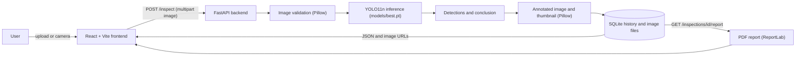

# PCB-AI-Inspector

AI-assisted printed circuit board (PCB) defect inspection. Upload or capture a PCB image, run a fine-tuned **YOLO11n** detector through a **FastAPI** backend, review annotated results in a **React** interface, keep a local inspection history, and download a PDF report.

[](https://www.python.org/)
[](https://fastapi.tiangolo.com/)
[](https://react.dev/)
[](https://tailwindcss.com/)
[](https://docs.ultralytics.com/)

> **Status: research / portfolio project.** The model was evaluated on a held-out test set containing only **two physical PCB boards**, and it produces many false positives for the **Short** class. The results below are experimental and are **not** evidence of real-world or production accuracy. See [Known limitations](#known-limitations).

**Live demo:** not deployed yet. Run it locally with the instructions below.

## Contents

- [Overview](#overview)
- [Key features](#key-features)
- [Screenshots](#screenshots)
- [System architecture](#system-architecture)
- [Inspection workflow](#inspection-workflow)
- [Technology stack](#technology-stack)
- [Supported defect classes](#supported-defect-classes)
- [Model performance and evaluation](#model-performance-and-evaluation)
- [Installation and setup](#installation-and-setup)
- [API endpoints](#api-endpoints)
- [Model and dataset information](#model-and-dataset-information)
- [Research folder](#research-folder)
- [Deployment notes](#deployment-notes)
- [Known limitations](#known-limitations)
- [Future improvements](#future-improvements)
- [Project structure](#project-structure)
- [Author, contributing and license](#author-contributing-and-license)

## Overview

PCB-AI-Inspector detects six PCB defect types in a single image. The backend loads the trained weights (`models/best.pt`, the **Exp2 Best** YOLO11n checkpoint) once at startup, validates each upload, runs inference, draws the detections, stores the result in SQLite, and can generate an A4 PDF report. The React frontend has three screens: **Landing**, **Inspection** and **Results**.

The detector is an assistive tool. A result of "No Visible Defect Detected" does not prove that a board is defect-free, and every detection should be confirmed by manual inspection.

## Key features

- **Image input:** drag-and-drop or file picker (JPG, PNG, WEBP; up to 10 MB), or capture with the device camera (browsers allow camera access only on `https://` pages or `localhost`). One image per inspection.
- **Validation in the browser and on the server:** file type is checked from the file signature (not the file name), size, decodability and image dimensions.
- **Six-class defect detection** with bounding boxes and confidence scores. Detections at or above 25% confidence are reported.
- **Three-state conclusion:** *Potential Defect Detected*, *Inconclusive*, or *No Visible Defect Detected* (see [Inspection workflow](#inspection-workflow)).
- **Results page:** side-by-side, original-only or annotated-only view, zoom from 1x to 4x, annotated-image download, per-detection list and per-class summary.
- **Local inspection history** stored in SQLite: reopen or delete past inspections.
- **PDF report** (ReportLab, A4): inspection details, conclusion, original and annotated images, detection table, model information, held-out test results and a limitations disclaimer.
- **Interactive API documentation** at `/docs` (FastAPI) and two legacy prediction endpoints.

## Screenshots

No screenshots are committed yet. Placeholders:

| Screen | Status |
|---|---|
| Landing page | _Not yet added_ |
| Inspection page (upload / camera / history) | _Not yet added_ |
| Results page (annotated image, detections) | _Not yet added_ |
| Generated PDF report | _Not yet added_ |

## System architecture



The model is loaded once at startup and guarded by a lock because the YOLO predictor is not thread-safe. If `models/best.pt` is missing, the backend stops at startup with an explicit error message.

## Inspection workflow

1. The user selects, drops or captures one image. The frontend validates it (format by file signature, maximum 10 MB, decodable).
2. The frontend sends it to `POST /inspect` as multipart form data (field name `file`).
3. The backend validates it again: JPEG, PNG or WEBP detected from the file bytes; at most 10 MB; at most 60 million pixels; at least 16 x 16 pixels. EXIF orientation is applied and the image is converted to RGB.
4. YOLO runs **once** at `imgsz=640` with a 10% confidence floor.
5. Detections with confidence >= 25% are kept, sorted by confidence and numbered. Weaker candidates (10% to 25%) are only counted, not reported as defects.
6. The conclusion is decided:

   | Conclusion | Condition |
   |---|---|
   | Potential Defect Detected | at least one detection with confidence >= 25% |
   | Inconclusive | no detection >= 25%, but weaker candidates exist **or** the shorter image side is under 320 px |
   | No Visible Defect Detected | otherwise (not proof of a defect-free board) |

7. An annotated JPEG is drawn with Pillow, a 256 px thumbnail is created, and the original image, annotated image and thumbnail are saved under `backend/storage/`. The record is written to SQLite and an ID such as `PCB-20261103-1A2B3C` is returned.
8. The frontend opens `/results/<id>`, which loads the saved result (`GET /inspections/{id}`) **without re-running YOLO**.
9. The PDF is built with ReportLab on the first `GET /inspections/{id}/report` request and cached in `backend/storage/reports/`.

## Technology stack

| Layer | Technology |
|---|---|
| Frontend | React 19, Vite 8, Tailwind CSS 4 (`@tailwindcss/vite`), lucide-react, ESLint |
| Backend | Python 3.10+, FastAPI, Uvicorn, python-multipart |
| Computer vision | Ultralytics YOLO11n, PyTorch (installed as an Ultralytics dependency), Pillow |
| Database | SQLite (Python standard-library `sqlite3`) |
| PDF reports | ReportLab |

Versions are the ones in `frontend/package.json` and `backend/requirements.txt`. Backend dependencies use minimum versions only (`>=`) and are not pinned.

## Supported defect classes

The model has **six** classes. The class IDs and names below are stored in the model weights and in `configs/data.yaml` and `configs/pcb_final.yaml`. The repository does not define abbreviations for them.

| ID | Class name (model / API) | Display name (UI) | Description (as shown in the UI) |
|---:|---|---|---|
| 0 | `mouse_bite` | Mouse bite | Small, irregular notches bitten out of the board edge or a copper trace. |
| 1 | `spur` | Spur | Unwanted copper spikes protruding from a trace. |
| 2 | `missing_hole` | Missing hole | A drilled hole that should be present but is absent. |
| 3 | `short` | Short | Unintended copper bridging between two conductors. |
| 4 | `open_circuit` | Open circuit | A break in a trace that interrupts the electrical path. |
| 5 | `spurious_copper` | Spurious copper | Leftover copper residue where none belongs. |

## Model performance and evaluation

**Selected model:** Exp2 Best YOLO11n checkpoint, `models/best.pt`.

### Held-out test results

| Metric | Value |
|---|---:|
| Macro precision | 80.00% |
| Macro recall | 96.83% |
| mAP@50 | 94.04% |
| mAP@50-95 | 42.44% |

Precision and recall are **unweighted means of the six per-class values** at a confidence threshold of 0.25. They are not overall accuracy.

### Test results by class

| Class | Precision | Recall | False positives | False negatives |
|---|---:|---:|---:|---:|
| mouse_bite | 97.82% | 96.22% | 21 | 37 |
| spur | 81.15% | 97.14% | 213 | 27 |
| missing_hole | 94.47% | 96.25% | 57 | 38 |
| **short** | **42.99%** | 94.69% | **1135** | 48 |
| open_circuit | 82.78% | 98.14% | 187 | 17 |
| spurious_copper | 80.80% | 98.54% | 192 | 12 |

### Evaluation protocol

- **Test split:** 2,232 images and 5,576 annotated defect instances from two physical boards (boards 11 and 12). The model never trained on these boards.
- **Evaluator:** a custom script. Predictions were generated at `conf=0.001`, `imgsz=640`. Precision, recall and the counts above use confidence >= 0.25 and IoU >= 0.50 with greedy matching per class and image. AP uses 101-point interpolation.
- **Checkpoint selection:** the checkpoint was chosen using the validation split. Earlier model versions were also evaluated on this test split during development, so treat it as a development benchmark rather than a pristine one-shot hold-out.
- **Reproducibility gap:** the script that produced these test metrics is **not yet included** in this repository. The evaluation scripts in `research/` operate on the validation split.

### What these numbers do and do not show

They describe performance on two specific boards. They do **not** measure real-world or production accuracy. See [Known limitations](#known-limitations) for the Short-class false-positive problem. Further testing on a larger and more diverse set of boards is required.

## Installation and setup

### Prerequisites

- Python 3.10 or newer
- Node.js 20.19+ or 22.13+ (required by the locked Vite 8 and ESLint 10 versions)
- Git
- Enough disk space for PyTorch (installed through `ultralytics`)

The model weights are included in the repository (`models/best.pt`, about 5.5 MB). Datasets are not included.

```bash
git clone https://github.com/abdus004/PCB-AI-Inspector.git
cd PCB-AI-Inspector
```

### Backend

From the repository root:

```bash
python -m venv .venv

# Windows PowerShell
.\.venv\Scripts\Activate.ps1
# macOS / Linux
source .venv/bin/activate

pip install -r backend/requirements.txt
cd backend
uvicorn main:app --reload --host 127.0.0.1 --port 8000
```

Run `uvicorn` from inside the `backend/` folder: the backend modules import each other by name (`import config`, `from services import ...`).

- API root: http://127.0.0.1:8000
- Interactive docs: http://127.0.0.1:8000/docs
- Health check: http://127.0.0.1:8000/health

### Frontend

In a second terminal:

```bash
cd frontend
npm install
npm run dev
```

Open the URL printed by Vite (by default http://localhost:5173). Other scripts: `npm run build`, `npm run preview`, `npm run lint`.

The frontend calls `http://127.0.0.1:8000` by default. To use another backend address, copy `frontend/.env.example` to `frontend/.env` (Windows: `Copy-Item .env.example .env`), set `VITE_API_BASE_URL`, and restart the dev server.

### Environment variables

All variables are optional for local use.

| Variable | Where | Default | Purpose |
|---|---|---|---|
| `CORS_ORIGINS` | backend | `http://localhost:5173`, `http://127.0.0.1:5173`, `http://localhost:4173`, `http://127.0.0.1:4173` | Comma-separated frontend origins allowed by CORS |
| `PCB_MODEL_PATH` | backend | `<repo root>/models/best.pt` | Use a different weights file |
| `PCB_STORAGE_DIR` | backend | `backend/storage` | Where images and PDFs are stored |
| `PCB_DB_PATH` | backend | `backend/inspections.db` | SQLite database file |
| `VITE_API_BASE_URL` | frontend (build time) | `http://127.0.0.1:8000` | Backend base URL |

Backend variables can be set in the environment or in `backend/.env` (see `backend/.env.example`, which lists the first two). The `.env` files are git-ignored.

### Troubleshooting

- **"Model weights not found":** `models/best.pt` must exist at the repository root, or set `PCB_MODEL_PATH`.
- **"Cannot reach the inspection server":** the backend is not running, or `VITE_API_BASE_URL` points to the wrong address.
- **CORS error in the browser console:** add the frontend origin to `CORS_ORIGINS` and restart `uvicorn`.
- **First inspection is slow:** the first inference warms up the model.
- **Camera tab unavailable:** use `localhost` or `https://`, or use Upload instead.

## API endpoints

Verified against `backend/main.py`. Inspection IDs have the form `PCB-YYYYMMDD-XXXXXX`.

| Method | Path | Description |
|---|---|---|
| GET | `/` | Service status message |
| GET | `/health` | Health status and whether the model is loaded |
| GET | `/model-info` | Model name, classes, image size, confidence threshold, evaluation summary |
| POST | `/predict` | Legacy: JSON detections for an uploaded image (nothing is saved) |
| POST | `/predict/annotated` | Legacy: annotated JPEG (nothing is saved) |
| POST | `/inspect` | Validate, run YOLO once, annotate, save, return full results (`201`); form field `file` |
| GET | `/inspections?limit=&offset=` | History list (`limit` 1 to 100, default 10) |
| GET | `/inspections/{id}` | Saved results (does not re-run YOLO) |
| GET | `/inspections/{id}/original` | Stored original image |
| GET | `/inspections/{id}/annotated` | Stored annotated image |
| GET | `/inspections/{id}/thumbnail` | Stored thumbnail |
| GET | `/inspections/{id}/report` | PDF report (built on first request, then cached) |
| DELETE | `/inspections/{id}` | Delete the record and its stored files |

Errors are returned as JSON: `400` invalid image, `413` file or image too large, `404` unknown inspection, `500` unexpected server error.

```bash
curl -X POST -F "file=@board.jpg" http://127.0.0.1:8000/inspect
```

## Model and dataset information

### Model

| Item | Value |
|---|---|
| File | `models/best.pt` (5,503,834 bytes) |
| SHA-256 | `c8338721a4bfd4b9fe2e8e97ef108704f007d6080d2bf81bf96323cc0274f517` |
| Architecture | YOLO11n, six classes |
| Framework | Ultralytics (weights saved with 8.4.202) |
| Input size | 640 |
| Fine-tuning recipe (from checkpoint metadata) | started from an earlier 30-epoch checkpoint (not included in this repository); AdamW, `lr0` 0.0003, batch 16, 20 planned epochs, early-stopping patience 8, seed 0 |

The recipe is implemented in `research/train_colab_exp2.py` (Google Colab T4).

### Dataset

The dataset itself is **not** in this repository (`datasets/` is git-ignored). Split sizes come from `reports/board_split_proposal.csv`.

| Split | Boards | Images | Defect instances |
|---|---|---:|---:|
| Train | 01, 04, 05, 06, 07, 08 | 6,808 | 12,368 |
| Validation | 09, 10 | 1,628 | 3,720 |
| Test | 11, 12 | 2,232 | 5,576 |
| **Total** | 10 boards | **10,668** | **21,664** |

- Images are 600 x 600 pixels (a few are 601 x 601). Each capture exists in four variants, encoded in the file names: `light`, `l_light`, `rotation_90_light`, `rotation_270_light`.
- The split is **board-level** so that images of the same physical board do not appear in more than one split. An earlier random split was found to contain near-identical images across splits (see `reports/pair_inspection/pairs.csv`).
- **Dataset source and license: not documented in this repository.** _To be added by the project owner._

## Research folder

`research/` contains the supporting dataset-preparation, auditing, evaluation and training utilities used to build and assess the model. It is **not** part of the application runtime: the backend and frontend do not import anything from it, and none of these scripts is an API component.

How to use the scripts:

- Run them **from the repository root**, for example `python research/audit_splits.py`. They use paths relative to the working directory (`datasets/...`, `reports/...`, `configs/...`).
- Most need the dataset, which is not included. Place it under `datasets/` as the scripts expect.
- They need packages beyond `backend/requirements.txt` and there is no requirements file for `research/` yet. Imports include `numpy`, `pandas`, `opencv-python`, `matplotlib`, `scikit-learn`, `PyYAML`, `Pillow`, `torch` and `ultralytics`.

| Purpose | Files |
|---|---|
| Training (Google Colab T4) | `train_colab_exp1.py`, `train_colab_exp2.py`, `COLAB_TRAINING_GUIDE.md` |
| Dataset preparation | `prepare_grouped_split.py` (an earlier grouped random split, not the final split), `copy_final_dataset.py` (builds `datasets/pcb-yolo-final` from `reports/board_split_proposal.csv`), `check_final_dataset_copy.py`, `verify_final_dataset.py` |
| Dataset auditing | `audit_filenames.py`, `audit_splits.py`, `audit_labels_deep.py`, `audit_dataset_quality.py`, `audit_box_sizes.py`, `audit_augmentation.py`, `check_annotations.py`, `inspect_filenames.py`, `investigate_pairs.py` |
| Evaluation (validation split) | `analyze_predictions.py`, `check_threshold_robustness.py`, `evaluate_class_thresholds.py`, `evaluate_nms_sweep.py` |
| Visual inspection | `create_annotation_review.py`, `create_box_crops.py`, `visualize_annotations.py` |

Related folders:

- `configs/` has the Ultralytics dataset YAML files (`data.yaml`, `pcb_final.yaml`). The application does not read them.
- `reports/` has split manifests (`manifest_all.csv`, `board_split_proposal.csv`), audit CSVs, and generated review images that the scripts above can recreate.

## Deployment notes

**No deployment configuration is committed yet** (no `render.yaml`, `vercel.json` or `Procfile`), and no deployment has been tested. These notes describe what the code requires:

- **Backend:** install `backend/requirements.txt`, start with `uvicorn main:app --host 0.0.0.0 --port <port>` **from inside `backend/`**, and keep `models/best.pt` available (or set `PCB_MODEL_PATH`). If the host limits the service to the `backend/` directory, the default model path will not resolve. Set `CORS_ORIGINS` to the exact frontend URL. Memory and CPU needs of PyTorch inference have not been measured.
- **Storage:** history, images and PDFs are written to local disk. On hosts with an ephemeral filesystem, including free tiers of some platforms, they are lost on restart or redeploy. Point `PCB_STORAGE_DIR` and `PCB_DB_PATH` at a persistent volume.
- **Frontend:** `npm run build` produces a static site in `frontend/dist`. The app uses real URL paths (`/inspect`, `/results/<id>`), so the static host must serve `index.html` for unknown paths (for example with a rewrite rule). Set `VITE_API_BASE_URL` **at build time**.
- **Security:** the API has no authentication or rate limiting. Do not expose it publicly without adding them.

## Known limitations

- **Very small test set.** The held-out test contains only two physical boards, so the reported metrics say little about other boards, cameras, lighting or layouts. Training used 6 boards and validation used 2.
- **Short class false positives.** On the test set, `short` has 42.99% precision with 1,135 false positives, although recall is 94.69%. At the default 0.25 threshold the model flags many non-defects as shorts. The cause has not been resolved. `spur`, `open_circuit` and `spurious_copper` also have precision around 81% to 83%.
- **Metrics are not production accuracy.** Precision and recall are macro averages at one threshold; mAP@50-95 (42.44%) is much lower than mAP@50 (94.04%).
- **Training data are small image crops.** The model was trained on 600 x 600 images. Behaviour on full-board photographs or other imaging setups is untested.
- **Limited independent backgrounds.** Captures of the same board share near-identical backgrounds, so the number of independent layouts is small.
- **Six defect types only.** Anything else is not detected, and "No Visible Defect Detected" never means a board is defect-free.
- **Single image per inspection,** local storage only, no authentication, no automated tests and no CI.
- **Test-metric script missing.** The custom evaluator behind the reported test results is not yet in the repository.

## Future improvements

- Evaluate on a larger and more diverse set of boards and imaging conditions.
- Investigate the Short-class false positives and calibrate per-class confidence thresholds on validation data.
- Add the test-evaluation script and a requirements file for `research/`.
- Pin dependency versions and add deployment configuration.
- Add automated tests, CI and a license.
- Add authentication and persistent storage before any public deployment.

## Project structure

```
PCB-AI-Inspector/
  README.md
  .gitignore
  backend/                  FastAPI application (runtime)
    main.py                 App, CORS and all routes
    config.py               Paths, thresholds, limits, CORS, evaluation summary
    database.py             SQLite helpers (inspections table)
    requirements.txt
    .env.example
    services/
      images.py             Image validation and thumbnails
      model.py              Loads best.pt once, thread-safe inference
      inspection.py         Inspection workflow, conclusions, annotation, history
      report.py             PDF report (ReportLab)
    storage/                Runtime files (originals, annotated, reports, thumbnails)
  frontend/                 React 19 + Vite + Tailwind CSS 4
    package.json
    vite.config.js
    .env.example
    index.html
    public/                 Static assets
    src/
      App.jsx               Chooses the page from the URL
      pages/                LandingPage, InspectionPage, ResultsPage
      components/           UploadZone, CameraCapture, ImageViewer, DetectionList,
                            HistoryList, Header, Logo, PcbHero, Link, ui
      services/api.js       All requests to the backend
      lib/                  router, imageValidation, format, status
      data/content.js       Landing-page text and displayed metrics
  models/
    best.pt                 Exp2 Best YOLO11n weights
  configs/                  Ultralytics dataset YAML files (not used at runtime)
  reports/                  Split manifests, audit CSVs, generated review images
  research/                 Dataset, audit, evaluation and training scripts (not runtime)
```

## Author, contributing and license

- **Author:** [abdus004](https://github.com/abdus004) on GitHub.
- **Contributing:** this is a personal project. Feedback and bug reports are welcome as GitHub issues.
- **License:** no license file is included yet, so no permissions are granted by default. The model checkpoint's metadata records the Ultralytics license as AGPL-3.0 (https://ultralytics.com/license); review those terms before choosing a license or deploying the service.